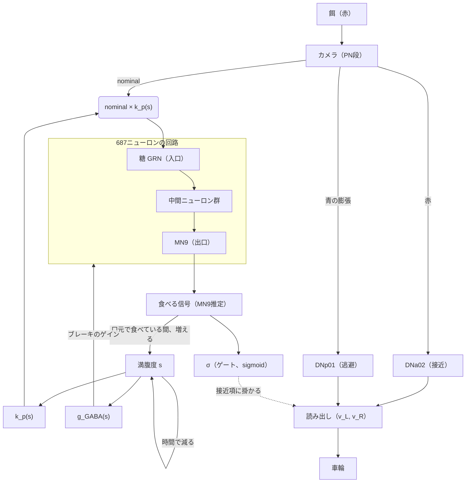

# flyforager_q — 実機アプリ

赤い「餌」を探して近づく、差動2輪の採餌ロボット。食べるかどうか
を決めるのは、ショウジョウバエの脳（コネクトーム）から抽出した
神経回路である。空腹のときは薄い餌でも食べに行き、満腹になると
目の前にあっても近づかなくなる。青いものが近づいてくれば、
お腹の具合によらず逃げる。

入力は2つだけ。カメラの画像（赤＝餌、青の膨張＝何かが近づいて
くる）と、内部状態である満腹度（食べるたびに上がり、時間とともに
下がる）。

処理は2つの回路が並行して担う。視覚回路は赤の方向と青の膨張から
車輪の指令を作る。採餌回路は同じ目の信号を受けて、運動ニューロン
MN9 の発火として「食べる／食べない」を出す。ロボットが赤に
近づくのは、採餌回路が「食べる」と言っている間だけである。
採餌回路の効き方は満腹度で変わる——それが、このロボットの性格が
空腹と満腹で変わって見える理由である。ロボットの状態は UNO Q の
LED マトリクスに表示され、判断と、赤と青の検出量と、満腹度が
外から見える。

以下ではこの処理の中身を、並行する2回路の流れ、駆動のモデル、
数理モデル、空腹／満腹の状態定義の順に述べる。アプリの構成は
fly-car の flycar_q に倣う。

## 並行に流れる2つの回路（python/main.py）

ハエの脳では、見る回路と食べる回路が同時に流れ続けている。
このロボットも同じで、2つの回路はそれぞれの速さで連続に進み、
信号だけで結合する。「判断する瞬間」というものはなく、ロボットは
いつも現在の入力に応え続けている。

- 視覚回路（plant.py、fly-car のモデル）はメインループの刻み
  （LOOP_S = 0.1 秒）で連続に進む。毎刻み、最新フレームと loom で
  膜を実時間ぶん進め、車輪を指令し直す。
- 採餌回路（C++ カーネル）は別スレッドで 1 秒試行を連続に回す
  （1 試行 = 脳時間 1 秒、実機で約 0.2 秒）。直近2試行の平均が
  「現在の MN9 発火率」で、最大でも約 0.4 秒遅れの推定値になる。
- 結合信号は2つだけ：カーネルの入力レートは DNa02 を駆動する
  同じ目の PN 出力の平均 × NOMINAL_MAX。MN9 推定値が 10 Hz 以上で
  ゲート σ が開き、fly-car の接近項が通る（下記）。

この連続状態を外から読む仕組み（LED とログ）は、回路の話と
分けて「可視化」の章にまとめた。ベンチモード（MANUAL_RATE）
では車輪を駆動しない（「ベンチモード」の章）。

## 駆動 — fly-car のモデル＋採餌ゲート

駆動は [fly-car の数理モデル](https://github.com/hamling-ling/fly-car/blob/main/poster/poster.md)
そのもの（plant.py に flycar.behavior から移植。pulse.py に
flycar.pulse のデッドバンド変換）。変更は1か所だけで、読み出しの
接近項（DNa02）に採餌回路のゲート σ が掛かる:

$$
v_L = k \cdot \left(\sigma \cdot r_R^{\mathrm{DNa02}} - r_R^{\mathrm{DNp01}}\right), \qquad
v_R = k \cdot \left(\sigma \cdot r_L^{\mathrm{DNa02}} - r_L^{\mathrm{DNp01}}\right)
$$

$$
\sigma = \frac{1}{1 + \exp\left(-\dfrac{\widehat{\mathrm{MN9}} - \theta}{w}\right)}, \qquad \theta = 10\ \mathrm{Hz}
$$

記号の説明：

- $v_L$ 、 $v_R$ は左右の車輪速度
- $r^{\mathrm{DNa02}}$ は接近を担う下降ニューロン DNa02 の発火率。
  赤を見た視覚回路が駆動する。添字の L／R は左右どちらの側か
- $r^{\mathrm{DNp01}}$ は逃避を担う下降ニューロン DNp01 の発火率。
  青の膨張（loom）が駆動する
- $k$ は発火率を車輪速度に換算する係数（コードでは `FORWARD_PER_HZ`）
- $\sigma$ は採餌ゲートで、0 から 1 の連続値。 $\widehat{\mathrm{MN9}}$ の
  sigmoid で、閾値 $\theta$ で 0.5 になる。幅 $w$ は config の
  `SIGMA_WIDTH_HZ`。満腹が進んで $\widehat{\mathrm{MN9}}$ が下がると、
  接近も滑らかに弱まる
- $\widehat{\mathrm{MN9}}$ は採餌回路の運動ニューロン MN9 の発火率の
  推定値。カーネルが回し続ける 1 秒試行の直近2回の平均で、
  10 Hz 以上なら「食べる（EAT）」、未満なら「食べない（refuse）」
  （詳しくは数理モデルの章）

満腹で refuse になれば赤への接近だけが消え、逃避項と安全停止は
そのまま残る。目の入力（赤の左右レンジ被覆率と重心 place）は
food.py の red_eyes が flycar.occupancy と同じ定義で測り、
採餌回路への公称レートは同じ目の PN 段出力の平均 × 150 Hz。
生の被覆率だと、端の小さい赤（被覆率 0.06 でも place 利得で
DNa02 は 170 Hz 級）が公称 6 Hz に潰れてゲートが開かないため、
DNa02 を駆動する変換後の信号を共有する。中央 ROI（画像中央の
注目領域）の被覆率はログ表示と満腹加算の判定のみ。
満腹度の加算は「口元」（中央 ROI の被覆率が `FILL_FULL`
以上）で EAT のときだけ — 遠くの EAT はゲートを開くが、着く前に
満腹にはしない。両眼 0.75 の安全停止 fill は顔に紙を押し当てた
条件で、手持ちデモでは届かない（両眼は 0.2 前後に留まる）。
スケッチの motors は flycar_q からの移植（setMotorSpeed、右ピン3／
左ピン5、3秒ウォッチドッグ）。車輪指令は LOOP_S ごとに更新する。

青の loom も fly-car と同一：loom.py と occupancy.py は
flycar からの逐語コピー（import の1行だけ変更）、閾値は同じ
color_thresholds.json、細胞表は同じ loom_cells.npz（fly-car の
src/flycar/ からコピーする二進ファイル。SHA256
e02722fcd8d311b3714fe05842f57c8632676058e4525ec381d55515fd71036b）。
Counts は flycar_q と同じ 10 Hz で別スレッドが更新し、メインループは
最新の loom 電流を plant.steps に渡す。DNp01 は σ でゲートされ
ない（満腹でも青からは逃げる）。到着停止は back（逃避）のとき
効かない。赤の経路だけはこのアプリの調整済み（food.py）のまま。

未移植：fly-car の直進ヒンジ補正。速度の実測もまだない
（m/s は公称）。

## 数理モデル

全体は、視覚回路と採餌回路が並行に流れ、2本の信号だけで結合した
系である。判断周期はなく、すべての量は連続時間の関数。

目の変換（fly-car と同一の PN 段。PN は投射ニューロン
（projection neuron）で、この段は目の被覆率と重心から飽和型の
駆動を作る。 $i \in \{L, R\}$ 、 $c_i$ は目の赤被覆率、
$\mathrm{place}$ は赤の重心）：

$$
u_i = \mathrm{PN}(c_i, \mathrm{place})
$$

採餌回路への入力は、DNa02 を駆動するのと同じ変換後の信号：

$$
\rho = \rho_{\max} \cdot \frac{u_L + u_R}{2}, \qquad \rho_{\max} = 150\ \mathrm{Hz}
$$

$\rho$ は採餌回路への公称入力レートで、餌の濃さに相当する。
実効入力レートは $k_p \rho$ で、20 個の糖 GRN への Poisson 入力に
なる。採餌回路は抽出サブサーキット（687 ニューロン、LIF）で、
GABA 作動性出力の重みに $g_{\mathrm{GABA}}$ を掛ける。その出力に
ある運動ニューロン MN9 は、ハエでは口吻の筋肉を駆動する細胞で、
その発火がこのロボットの「食べる」信号になる。
回路の構造を図にすると：



1 秒試行の MN9 スパイク数を $N_j$ として、

$$
\widehat{\mathrm{MN9}} = \frac{N_j + N_{j-1}}{2}\ \mathrm{Hz}
$$

$$
\sigma = \frac{1}{1 + \exp\left(-\dfrac{\widehat{\mathrm{MN9}} - \theta}{w}\right)}, \qquad \theta = 10\ \mathrm{Hz}
$$

$\theta$ は閾値、 $w$ は sigmoid の幅（config の
`SIGMA_WIDTH_HZ`）。 $\sigma$ は車輪へのゲートにだけ使う連続量で、
食べる／食べないの二値の判定（LED とログの表示、満腹度の加算）は
$\widehat{\mathrm{MN9}} \ge \theta$ のままである。

駆動の読み出し（fly-car の交差読み出し＋ゲート $\sigma$ ）：

$$
v_L = k \cdot \left(\sigma \cdot r_R^{\mathrm{DNa02}} - r_R^{\mathrm{DNp01}}\right), \qquad
v_R = k \cdot \left(\sigma \cdot r_L^{\mathrm{DNa02}} - r_L^{\mathrm{DNp01}}\right)
$$

$r^{\mathrm{DNp01}}$ は loom（LC4／LPLC2 → DNp01、fly-car と同一）
から来て、 $\sigma$ ではゲートされない。回転キャップ・車輪フィルタ・
赤の安全停止は fly-car のまま。

満腹度 $s \in [0, 1]$ は率で積分する：

$$
\frac{ds}{dt} = \begin{cases}
+\dfrac{1}{T_{\mathrm{eat}}} & \widehat{\mathrm{MN9}} \ge \theta \text{ かつ } \varphi \ge \varphi_{\mathrm{full}} \\
-\dfrac{1}{T_{\mathrm{hungry}}} & \text{それ以外}
\end{cases}
$$

ここで $T_{\mathrm{eat}}$ は満腹までの食事時間（config の
`EATS_TO_FULL` × `EAT_STEP_S`）、 $T_{\mathrm{hungry}}$ は
空腹に戻る時間（config の `HUNGER_RETURN_S`）、 $\varphi$ は
中央 ROI の赤被覆率、 $\varphi_{\mathrm{full}}$ は「口元」の
閾値（config の `FILL_FULL`）。

内部状態は満腹度 $s$ で、パラメータは $s$ から決まる。
パラメータから満腹度が決まることはない。パラメータ対
$(k_p, g_{\mathrm{GABA}})$ は $s$ の区分線形補間で、比例ではない
（ $k_p$ は下がり、 $g_{\mathrm{GABA}}$ は上がる）：

$$
k_p = \begin{cases}
1.5 - 1.0 \cdot s & 0 \le s \le 0.5 \\
1.0 - 0.66 \cdot (s - 0.5) & 0.5 \le s \le 1
\end{cases}
\qquad
g_{\mathrm{GABA}} = \begin{cases}
0.7 + 0.6 \cdot s & 0 \le s \le 0.5 \\
1.0 + 0.6 \cdot (s - 0.5) & 0.5 \le s \le 1
\end{cases}
$$

端点と中点が測定した3点（hungry／base／satiated）である。
$s$ が上がる（満腹に近づく）ほど $k_p$ は下がって入力の感度が
下がり、 $g_{\mathrm{GABA}}$ は上がってブレーキが強まる。その
結果、用量反応曲線が右へずれ、同じ濃さでも食べにくくなる。
満腹は拒否スイッチではなく曲線の移動なので、満腹でも濃い餌は
食べる — それが実測した satiated の曲線の答えである。

到着停止（提示層）： $\varphi \ge \varphi_{\mathrm{arr}}$
（config の `ARRIVE_FILL`）で車輪を止めてその場で食べる。
ただし逃避中（mode back）はそちらが優先する。

## 状態（空腹／満腹）

状態は実測パラメータ対（k_p, g_gaba）：

| 状態 | k_p | g_gaba | 効き方（実測） |
|---|---|---|---|
| base | 1.0 | 1.0 | EC50 72 Hz、食べ始め 60 Hz |
| hungry（H3） | 1.5 | 0.7 | EC50 42 Hz、食べ始め 40 Hz |
| satiated（S3） | 0.67 | 1.3 | EC50 113 Hz、食べ始め 100 Hz |

デモ中の切り替えは、アプリの隣（app.yaml と同じ場所）に置く
`state.txt` に `hungry` / `base` / `satiated` のいずれかを書く。
判断ごとに読み直すので、再起動は要らない。

`state.txt` に `auto` と書くと自動モードになる。満腹度（0〜1）が
判断に積算され、食べるたびに満腹側へ 1/5 ずつ進み、餌から離れて
いると10分かけて空腹側へ戻る。パラメータは hungry（0）→ base（0.5）
→ satiated（1）の実測3点を直線でつないだものを使う。
蓄積と回復の速さ自体は演出層の設計値で、実測は3点と用量反応曲線。

## 可視化 — LED とログ

回路の連続状態を外から読むための読み出し。どちらも判断ではなく、
いま回路に何が起きているかを人が追うためのものである。

LED マトリクス（8行×13列、単色）と RGB ランプ：

- 行0：赤の検出量バー（両目の赤被覆率の平均）
- 行1-4（eat）／行2-3（refuse）：判断バー。長さが MN9 推定値、
  ランプは eat で緑、refuse で赤。最後の更新から3秒で判断バー
  だけ消える
- 行5：青の検出量バー（両目の青被覆率の平均）
- 行6-7：満腹度ゲージ。左から満腹度ぶん点灯し、判断バーが消えても
  残る。内部の変数は連続な満腹度だけで、hungry／base／satiated は
  離散状態ではない（測定した3点が満腹軸の目盛り）。固定モードでは
  その目盛り位置を出す（hungry = 空、base = 半分、satiated = 全点灯）

ログは1秒ごとに状態行を1行出す。主な欄は、状態ラベルと現在の
パラメータ（k_p、g_gaba）、目の測定（fill、eye、place）、青の測定
（blue、loom、td = 膨張率）、公称レート nominal、カーネルの MN9
推定値と直近の試行カウント、EAT／refuse、車輪の指令（move、R/L、
dna、sigma）。ログの取り方そのものは「ログの取り方」の章。

## ベンチモード

カメラなしで判断だけ試す場合は config.py の `MANUAL_RATE` に
公称レート（例： 60.0）を入れる。カメラを開かず、その濃さで
判断し続ける。車輪は駆動しないので、机の上で、状態と判断の
対応（例： hungry は薄い餌で食べ、satiated は断る）を確かめる
ためのモード。LED とログには判断が出る。

## デプロイ

リポジトリのルートから：

```
scripts/deploy_flyforager_q.sh
```

fly-car の deploy と同じ流儀（停止 → コピー → スケッチのハッシュで
キャッシュ判定 → 起動）。カーネルのバイナリはコピーに含めず、
deploy の最中にボードのホスト側で g++ でビルドする
（App Lab のコンテナには g++ が無いので、アプリ自身はビルドできない）。

## ログの取り方

```
scripts/logs_flyforager_q.sh
```

実機アプリのログを流しながら `logs/flyforager_q-YYYYMMDD-HHMMSS.log`
に保存する。Ctrl-C で止めるとファイルが残る。期待する流れは
`kernel: built` → カメラの warmup → 1 秒ごとの状態行
（`state base fill ... MN9 ... refuse/EAT`）。

## カーネルのデータ

python/kernel/ の .bin は抽出回路の接続表（CSR 形式）。
w_base.bin が重み、gaba.bin が GABA ゲインを掛ける結合のマスク
（糖 GRN の出力は除外）。
出所と検証値は research/ と親リポジトリの README を参照。

.bin はリポジトリに入れず、Release（タグ `kernel-v1`）の
`kernel-data.zip` で配る。clone のあとに次を実行すると、
SHA256 とサイズを照合して python/kernel/ に配置される。

```
scripts/download_kernel_data.sh
```
